# DermaClass-Net Clinical AI Platform: Architecture & Verification Report

## 1. Executive Summary

The **Multi-Model Skin Cancer Detection (DermaClass-Net)** web application has been transformed from an in-memory research prototype into a clinical-grade medical AI platform. All mock in-memory stores and client-side `localStorage` data have been replaced with a real relational database, cryptographic two-factor authentication (2FA), doctor-generated unique Patient IDs, professional ReportLab clinical PDF reports, controlled report sharing, and an end-to-end support ticket system.

The dual-backbone ONNX model ([`dermaclass_net_final.onnx`](file:///c:/Users/reddy/OneDrive/Desktop/Multi-Model%20Skin%20Cancer%20Detection/dermaclass_net_final.onnx), 113.58 MB), skin centroid reference ([`isic_skin_centroid.pt`](file:///c:/Users/reddy/OneDrive/Desktop/Multi-Model%20Skin%20Cancer%20Detection/isic_skin_centroid.pt)), 3D Three.js interactive fusion mesh, and procedural dermoscopy canvas renderers have been fully preserved and connected to persistent database storage.

---

## 2. System Architecture & Role-Based Access Control (RBAC)

The application provides three dedicated portal experiences, accessible via the top navigation bar and authentication system:

```mermaid
graph TD
    A[DermaClass-Net Platform] --> B[Doctor Portal]
    A --> C[Patient Family Portal]
    A --> D[Chief Administrator Portal]
    A --> E[Public / Research Access]

    B --> B1[Patient Roster & Unique IDs: PAT01-DR001]
    B --> B2[AI Diagnostic Workspace & Gatekeeper]
    B --> B3[Clinician Review & Diagnostic Sign-Off]
    B --> B4[Clinical PDF Generation & Sharing]
    B --> B5[3D Adaptive Fusion & Grad-CAM]

    C --> C1[Patient Report Access via 2FA + ID]
    C --> C2[Verified Diagnostic Reports Dashboard]
    C --> C3[Consultation Appointment Booking]
    C --> C4[Patient Support Inquiries]

    D --> D1[Doctor Credential Verification]
    D --> D2[Global Patient & Scan Records]
    D --> D3[Support Ticket Helpdesk & Replies]
    D --> D4[System Health & Audit Logs Trail]
```



### Portal Profiles & Default Credentials
- **Doctor Portal**:
  - Email: `dr.evelyn.vance@dermaclass.med`
  - Password: `Doctor@2026`
  - Role: `DOCTOR` (Doctor Code: `DR001`, License: `MD-84920-DERM`)
- **Chief Administrator Portal**:
  - Email: `admin@dermaclass.med`
  - Password: `Admin@2026`
  - Role: `ADMIN`
- **Patient Access Portal**:
  - Self-service 2-Step Demographic Verification at `/patient/report-access` requiring official Patient ID (`PATxx-DRxxx`) + Demographic matching + 2FA OTP.

---

## 3. Core Technical Implementations

### A. Persistent Relational Database (SQLAlchemy)
- **Engine**: SQLAlchemy 2.0 with connection pooling, supporting SQLite and PostgreSQL via the `DATABASE_URL` environment configuration in [`backend/config.py`](file:///c:/Users/reddy/OneDrive/Desktop/Multi-Model%20Skin%20Cancer%20Detection/backend/config.py).
- **Core Entities** ([`backend/models/`](file:///c:/Users/reddy/OneDrive/Desktop/Multi-Model%20Skin%20Cancer%20Detection/backend/models/)):
  - `User`, `DoctorProfile`, `PatientProfile`: Authentication, profile data, license verification status.
  - `Patient`: Doctor-registered patients with unique index on `patient_code` (`PAT01-DR001`).
  - `Scan`: Original uploaded files, MIME types, anatomical metadata, dimensions.
  - `Prediction`: ONNX Dirichlet EDL probabilities, epistemic uncertainty (vacuity $u$), dual-backbone weights, inference timing.
  - `DoctorReview`: Formal clinical diagnosis, clinician notes, recommended actions, timestamped review status (`PENDING`, `REVIEWED`, `FOLLOW_UP_REQUIRED`).
  - `Appointment`: Clinical consultations linked between patients and doctors with calendar status.
  - `Notification`: In-app notification center with read/unread tracking.
  - `SupportTicket` & `SupportMessage`: Threaded communication between users and administrators.
  - `SharedReport`: Time-limited, revocable secure access tokens for third-party consultations.
  - `OtpToken`: Bcrypt-hashed 6-digit verification tokens with 5-minute expiry and attempt tracking.
  - `AuditLog`: Immutable audit trail for patient data access, diagnosis submissions, and system events.

### B. Cryptographic 2FA Verification & Patient ID System
- **Patient Code Generation**: Format `PAT{count:02d}-{doctor_code}` (e.g. `PAT01-DR001`), guaranteed unique at database level.
- **Digital Patient Card**: Printable modal card with medical typography, hospital affiliation, issue date, and QR code for clinic check-ins.
- **Two-Factor Demographic Gatekeeper**:
  1. Patient enters Patient Code (`PAT01-DR001`), Legal Name, Age, City, and District.
  2. Backend matches demographic records and generates a cryptographically random 6-digit OTP.
  3. Contact target is returned masked (e.g. `+1 ****321`) for privacy.
  4. Max 5 attempts enforced; expires in 5 minutes.
  5. Configurable `DEV_OTP_MODE=true` logs the OTP directly to server console and allows `123456` for automated testing.

### C. Clinical PDF Report Generation (ReportLab)
- Implemented in [`backend/services/pdf_service.py`](file:///c:/Users/reddy/OneDrive/Desktop/Multi-Model%20Skin%20Cancer%20Detection/backend/services/pdf_service.py).
- **Medical Report Structure**:
  - Header: Hospital affiliation, Attending Clinician, Patient ID, Acquisition Timestamp.
  - **Section 1: AI Clinical Decision Support**: Predicted lesion category, top probability, Dirichlet vacuity uncertainty score ($u = K / S$), dual-backbone fusion weights (DenseNet-121 / EfficientNet-B4).
  - **Section 2: Licensed Clinician Review & Attestation**: Clearly separated clinical box containing Attending Doctor diagnosis, clinical dermoscopy notes, recommended follow-up action, and electronic sign-off.
  - Footer: Strict legal disclaimer emphasizing decision-support status and mandatory physician oversight.

### D. Controlled Report Sharing
- Generates a 256-bit URL-safe token with configurable expiration (e.g., 7 days).
- Recipient view renders the full diagnostic report and clinician review without requiring an account, while logging access in the system audit log.
- Clinician or patient can revoke active sharing links at any time.

---

## 4. End-to-End Verification Test Results

An automated 13-stage test suite was executed via [`test_e2e_platform.py`](file:///c:/Users/reddy/OneDrive/Desktop/Multi-Model%20Skin%20Cancer%20Detection/test_e2e_platform.py):

| Test Stage | Description | Result | Details |
| :--- | :--- | :---: | :--- |
| **Stage 1** | System Health Check | **PASS** | Status: `healthy`, Model: `loaded`, Centroid: `loaded`, Storage: `healthy` |
| **Stage 2** | Model Specs & Architecture Info | **PASS** | `DermaClass-Net Multimodal Diagnostic Backbone`, 8 classes, ImageNet 224x224 |
| **Stage 3** | Doctor Authentication | **PASS** | JWT token issued for `dr.evelyn.vance@dermaclass.med`, role `DOCTOR` |
| **Stage 4** | Admin Authentication | **PASS** | JWT token issued for `admin@dermaclass.med`, role `ADMIN` |
| **Stage 5** | Patient Registration & ID Generation | **PASS** | Successfully generated `PAT09-DR001` with demographic persistence |
| **Stage 6** | Non-Skin Rejection Gatekeeper | **PASS** | Synthetic non-skin image rejected: `"Non-skin costume / cartoon graphics detected"` |
| **Stage 7** | ONNX Multimodal Inference | **PASS** | Scan `SCN-2026-0007`: Top class `VASC` (0.6969), Uncertainty (0.2629) |
| **Stage 8** | Clinician Review Sign-off | **PASS** | Doctor Evelyn Vance signed off with status `REVIEWED` |
| **Stage 9** | ReportLab PDF Report Generation | **PASS** | Generated 3,965 bytes valid `%PDF-` document with visual separation |
| **Stage 10** | Patient 2FA Demographic Access | **PASS** | Matched `PAT09-DR001` + demographic data, verified OTP, retrieved report |
| **Stage 11** | Controlled Report Sharing Link | **PASS** | Generated token `7fvg5I4...`, public access retrieved verified scan |
| **Stage 12** | Support Ticket System | **PASS** | User opened ticket; Admin responded; Status updated to `IN_PROGRESS` |
| **Stage 13** | Admin Dashboard & Audit Logs | **PASS** | 71 audit log events recorded across all lifecycle events |

---

## 5. Frontend Build Verification

The React + TypeScript + Vite frontend was built using `npm run build`:
- **TypeScript Compiler (`tsc -b`)**: 0 errors.
- **Vite Bundler**: Clean build in 1.39s. Output assets:
  - `dist/index.html`: 1.98 kB
  - `dist/assets/index-*.css`: 6.87 kB
  - `dist/assets/index-*.js`: 1,080.26 kB

---

## 6. How to Run the Platform

### Running the Full Unified Backend
```powershell
# From the project root
python app.py
```
*The server boots on `http://localhost:8000`. It serves all `/api/v1` REST endpoints, loads the ONNX model and skin centroid singleton into memory, and statically serves the compiled frontend from `dist/`.*

### Running the Frontend in Vite Hot-Reload Dev Mode
```powershell
# In a separate terminal
npm run dev
```
*Vite dev server starts on `http://localhost:5173` with proxy routing to the backend on port 8000.*

### Re-running the Automated E2E Test Suite
```powershell
python test_e2e_platform.py
```
